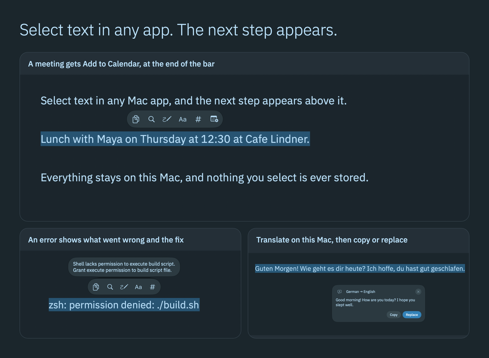
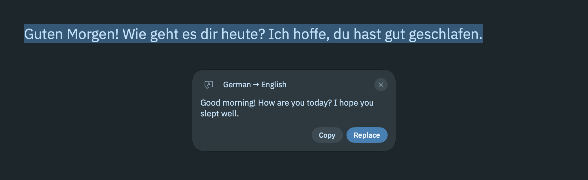
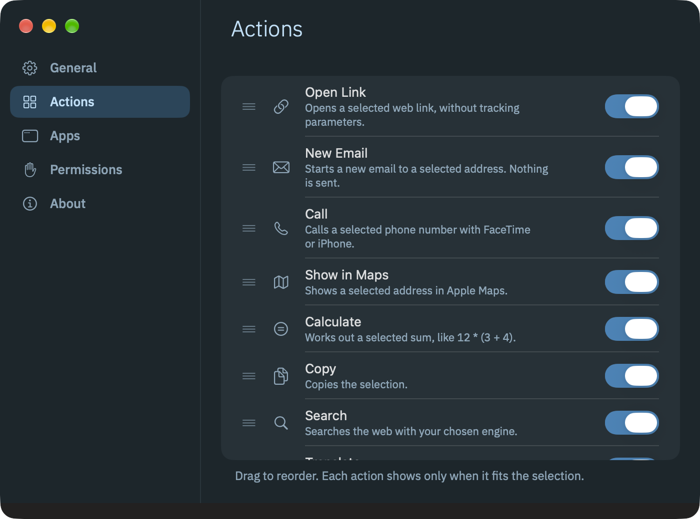

# Inkbar

[](https://github.com/gabrimatic/inkbar/releases/latest)
[](LICENSE)
[]()
[]()
[]()

**Select text in any Mac app and get a bar of actions for it: copy, search, translate, open a link, do a sum, look up a word, add it to your calendar, and more.**

Inkbar is a Liquid Glass bar for anyone who works with text on a Mac. It appears just above your selection and never takes focus from the app you are typing in. Apple Translation and Apple Intelligence do the language work on this Mac, and Inkbar never logs or stores what you select.

[Website](https://gabrimatic.github.io/inkbar/) · [Download](https://github.com/gabrimatic/inkbar/releases/latest) · [Contributing](CONTRIBUTING.md) · [Security](SECURITY.md)

<p align="center">
  
</p>

## Install

One line. It downloads the latest release, checks its SHA-256 against `SHA256SUMS.txt`, installs to `/Applications` and opens Inkbar:

```bash
curl -fsSL https://raw.githubusercontent.com/gabrimatic/inkbar/main/install.sh | bash
```

To read it first: [install.sh](install.sh). Options: `--no-open`, `INKBAR_VERSION=1.0.0`, `INKBAR_INSTALL_DIR=$HOME/Applications`.

Or download `Inkbar-<version>.dmg` (or the `.zip`) from [Releases](https://github.com/gabrimatic/inkbar/releases/latest) and drag Inkbar to Applications.

### First Open

Inkbar is free and open source. Release builds are signed ad hoc, not notarized, so macOS blocks the first open of a copy you downloaded in a browser. `install.sh` does not hit this.

1. Open Inkbar. macOS says it cannot verify the app. Choose **Done**.
2. Open **System Settings > Privacy & Security** and scroll to **Security**.
3. Next to the note that Inkbar was blocked, click **Open Anyway** and confirm.

You do this once per download. Because the signature is ad hoc, macOS can treat a new version as a new app: if a permission stops working after an update, switch Inkbar off and on in that list.

## What It Does

Select text with the mouse (drag, double-click, triple-click, Shift-click) or with Shift and the arrow keys. The bar appears just above the selection, or below it when there is no room above. It never sits under the menu bar, the Dock or the camera notch, and never spills off a screen.

<p align="center">
  
</p>

Actions show only when they fit the selection:

| Action | Shown when |
| --- | --- |
| Open Link | the selection is one web link (opened over https, tracking parameters removed) |
| New Email | the selection is one email address (opens a draft, nothing is sent) |
| Call | the selection is a phone number |
| Show in Maps | the selection is a street address, or names a place |
| Calculate | the selection is a sum, like `12 * (3 + 4.5) / 2`, `2^10` or `200 * 15%` |
| Copy | always |
| Search | up to 2,000 characters that are not a link or an email address; Google, DuckDuckGo, Kagi or Perplexity |
| Translate | text in another language than your target, up to 5,000 characters; on this Mac with Apple Translation |
| Apple Intelligence | text with letters, when Apple Intelligence is on and supports its language: Summarize, Explain, Rewrite (shorter, warmer and formal at once), Proofread (marks each word it changed), Reply (yes, no and a question), streamed from the on-device model |
| Look Up | one to three words, in Dictionary |
| Paste Clean | the field is editable and the clipboard has text: pastes it as plain, tidy text with clean links |
| Clean Copy | cleaning would change the text: copies it plain, with tidy whitespace and clean links |
| Change Case | the text has letters with case: UPPERCASE, lowercase, Title Case |
| Count | two or more words, or 20 characters: words, characters and lines |
| Letterboxd, IMDb | the selection names a film or series, such as `The Godfather`, or ends in a year in brackets, such as `Heat (1995)` |
| Shop, Amazon | the selection names a product, such as `MacBook` |
| Wikipedia | the selection names a person or company |
| Goodreads | the selection names a book |
| Apple Music | the selection names a band, album or song |

Apple Intelligence reads what a short selection names, on this Mac, and the matching buttons slide in at the end of the bar a moment later. It only picks a topic: every button and link is Inkbar's own.

**Cards.** Translate, Calculate, Count and Apple Intelligence results open a card with Copy. Translate, Calculate and Proofread add Replace when the field is editable. In Rewrite, Reply and Change Case you pick a row: it replaces the selection when the field is editable and copies otherwise.

<p align="center">
  
</p>

**Read ahead.** Apple Intelligence reads each selection on this Mac and gets the next step ready before you ask, with nothing to type:

- **A meeting** gets Add to Calendar, with the title, place and the right date worked out. Calendar shows the entry before it adds it.
- **Someone's details** get Add Contact, with their name, role, company, email and phone filled in. Contacts shows the card before it adds it.
- **Notes with work in them** get Add to Reminders, one task per action, with due dates from deadlines.
- **A message to you** in text you cannot edit gets Ready Replies: yes, no and a question, written before you open the card.
- **An error** shows what went wrong and the likely fix right beside the bar.
- **A long passage** shows its main point, and **a technical or foreign term** shows what it means. Click the note to copy it.

<p align="center">
  
</p>

**While the bar is up:**

- `1` to `9` run the actions in order and pick the rows in a card. `Esc` closes the bar or the card.
- Typing, scrolling, clicking elsewhere or switching apps dismisses it.
- Hovering a button shows its name and number.
- The bar appears with one short spring, and the Force Touch trackpad gives a light tap. Under Reduce Motion, Low Power Mode or a hot Mac there is only a short fade.

**Cleaning** removes `utm_*`, `fbclid`, `gclid`, `msclkid`, `si`, `igsh` and other tracking parameters from links, turns odd spaces into plain ones, drops zero-width characters (keeping the joiners emoji and Persian need), collapses runs of spaces, trims line ends and keeps at most one blank line. Indentation stays.

**Settings.** Open them from the menu bar icon, or by opening Inkbar again from Finder or Spotlight.

- **General:** show the bar automatically or only with a key held (Option, Command or Control); read ahead; number keys; trackpad haptics; reading selections in apps that hide their text; search engine; translation target; launch at login; show menu bar icon; Pause Inkbar.
- **Actions:** drag to reorder, switch each one on or off, Restore Defaults.
- **Apps:** per-app rules, "Only with key held" or "Never". Terminal, Warp, iTerm2 and Ghostty start as "Only with key held". Keychain Access, Passwords, 1Password and Bitwarden start as "Never". Add App… adds any other app.
- **Permissions:** the state of Accessibility, Apple Intelligence and Reminders, and a Welcome window row with Show Again.
- **About:** version, copyright, and a Using Inkbar section with the keys.

<p align="center">
  
</p>

**Menu bar.** Inkbar has no Dock icon. The menu bar icon's first line shows Inkbar and its state, then Pause Inkbar, Settings… (Command-comma), About Inkbar and Quit Inkbar (Command-Q). The icon is optional: switch it off in Settings > General to keep the room next to the notch, and open Inkbar from Finder or Spotlight to come back. The standard Mac menus show while an Inkbar window is in front, and Inkbar Help opens Settings > About.

**Shortcuts, Siri, Focus and Control Center:**

- **Shortcuts and Spotlight:** Show Inkbar for Selection, Toggle Inkbar, Pause or Resume Inkbar, Clean Text, Calculate, Translate Text on Device, Write with Apple Intelligence. Siri phrases include "Show Inkbar" and "Toggle Inkbar".
- **Focus:** add the Inkbar filter in System Settings > Focus to pause Inkbar during that Focus.
- **Control Center:** add the Inkbar control to pause or resume from Control Center or the menu bar. Its action runs inside the Inkbar app, so no other process can pause or resume Inkbar.

Nothing polls. Inkbar listens to the frontmost app's Accessibility "selected text changed" notification and to global mouse-down and mouse-up events. Its key tap and scroll watcher run only while the bar is on screen. At idle it uses near 0% CPU and under 15 MB of memory.

What Inkbar uses of the Mac, and what it leaves out on purpose: [docs/PLATFORM.md](docs/PLATFORM.md).

## Requirements

- Apple silicon (M1 or later)
- macOS 26 or later
- Optional: Apple Intelligence switched on in System Settings, for the Apple Intelligence action, read ahead and the buttons for what a selection names
- Optional: macOS 27, for the Control Center control

## Permissions

Inkbar needs one permission to work, and asks for a second only if you add tasks to Reminders.

| Permission | Why | Scope |
| --- | --- | --- |
| **Accessibility** | Reads the selected text and where it sits on screen, and writes text back for Replace and Paste Clean | The bar sees mouse clicks always, and the keys `1` to `9` and `Esc` only while it is on screen |
| **Reminders** | Saves tasks when you press Add on a task card | Asked the first time you do it, never before |

The welcome window's **Allow…** button shows the macOS prompt and adds Inkbar to **System Settings > Privacy & Security > Accessibility** for you. The state turns to **Allowed** by itself, with no relaunch. If you answered no, **Open System Settings** takes you to that pane. Settings > Permissions shows the same state, and **Show Again** brings the welcome window back.

Until Accessibility is allowed, the menu bar icon is dimmed and its menu links to the pane.

If switching Inkbar off and on does not bring Accessibility back after an update, remove it from the list with the minus button and press **Allow…** in Inkbar again.

Launch at login starts on: the first launch registers Inkbar as a login item. Switch it off in Settings > General or in System Settings > General > Login Items.

Translation may need a language download: the card offers **Download**, which shows the macOS prompt. Apple Intelligence is switched on in System Settings, and its card links there when it is off.

## Privacy

- Inkbar never logs or stores selected text. It writes its settings to disk, and a file that lasts a minute when you add to Calendar or Contacts. Tasks go to Reminders only when you press Add.
- Inkbar makes no network requests and has no account, telemetry or update checker. Translation and Apple Intelligence run on this Mac, and the text never leaves it. The model is told to treat the selection as material, never as instructions.
- Password fields and secure input (any app that turns it on, such as a password prompt) are always skipped.
- Every link is built with proper encoding and opened only if it is https, or `mailto:`, `tel:` or `dict:` handed to the Apple app for it. Plain http links are opened over https.
- Some apps (certain Electron and web views) do not expose their text to Accessibility. There, after a mouse selection only, Inkbar asks the app to copy, reads the text, and puts every item and type of your clipboard back exactly. If something else copies in that moment, the newer content wins.
- That clipboard fallback fails closed. It runs only when secure input is off, the selection's app is in front, and both the focused element and the element under the drag can be read, neither is a password field, and at least one is positively text. Drags that start on buttons, window chrome or file lists, and anything in Finder, never trigger it. Switch it off in Settings > General.
- Replace and Paste Clean write through Accessibility. Where an app refuses, Inkbar pastes and then restores your clipboard the same way.

Logs never contain selected text: `log stream --predicate 'subsystem == "info.gabrimatic.inkbar"' --info`

Details: [SECURITY.md](SECURITY.md).

## Limits

- Apps that neither expose their text nor answer Command-C (some games, canvases, remote desktops) get no bar.
- Selections made by Command-A or by the app itself (Find) do not show the bar; selections you make with the mouse or Shift and the arrow keys do.
- With number keys on, typing a digit right after selecting runs that action or is ignored, and never replaces the selection. Press any other key first, or turn number keys off.
- Translation covers the languages Apple Translation supports. The card says so for any other pair.
- Plain http links open over https only.

## Build from Source

Requirements: Xcode 27 or later (Swift 6).

```bash
git clone https://github.com/gabrimatic/inkbar.git
cd inkbar
./build.sh --install
```

`scripts/package.sh` builds the release files into `dist/`. Details: [CONTRIBUTING.md](CONTRIBUTING.md).

## Uninstall

Quit Inkbar and delete it from Applications. The login item goes with the app. Then remove its settings:

```bash
defaults delete info.gabrimatic.inkbar
```

Inkbar keeps nothing else: the calendar or contact file it hands over is deleted after a minute. To clear the rest, remove Inkbar from System Settings > Privacy & Security > Accessibility with the minus button, and from Control Center if you added its control.

## Contributing

Bug reports, ideas and pull requests are welcome: [CONTRIBUTING.md](CONTRIBUTING.md). Everyone taking part follows the [Code of Conduct](CODE_OF_CONDUCT.md). Security reports go through [SECURITY.md](SECURITY.md).

## License

MIT. See [LICENSE](LICENSE).

## Trademarks

Apple, Mac, macOS, Liquid Glass, Apple Intelligence, Apple Music, Spotlight, Siri, Shortcuts, Control Center, Finder and Dictionary are trademarks of Apple Inc., and Letterboxd, IMDb, Google, DuckDuckGo, Kagi, Perplexity, Amazon, Wikipedia, Goodreads, Warp, iTerm2, Ghostty, 1Password and Bitwarden are names of their owners; Inkbar uses them only to say what it works with and is not affiliated with or endorsed by any of them.

---

Created by [Soroush Yousefpour](https://gabrimatic.info)

[](https://www.buymeacoffee.com/gabrimatic)
